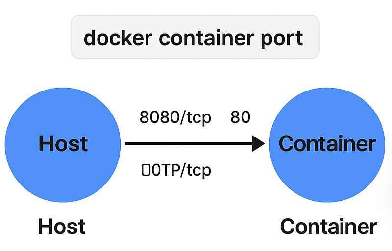

# 🚀 개발 워크스테이션 구축 프로젝트 결과보고서

## 1. 프로젝트 개요

본 프로젝트는 개발 환경 구축에 필요한 Linux 터미널 조작, 파일 권한 관리, Docker 컨테이너 운영 및 Git/GitHub 버전 관리 환경을 직접 구성하고 실습하는 것을 목적으로 한다.

### 주요 실습 목표
- Linux 기본 명령어를 활용한 파일 및 디렉터리 관리
- chmod를 이용한 파일 및 디렉터리 권한 관리
- Docker 이미지 및 컨테이너 생성과 관리
- Dockerfile을 활용한 커스텀 이미지 제작
- 포트 매핑을 통한 컨테이너 서비스 접속
- 바인드 마운트 및 Docker 볼륨을 통한 데이터 영속성 검증
- Git을 활용한 버전 관리 및 GitHub 연동

---

## 2. 실행 환경

| 구분 | 환경 및 버전 |
|---|---|
| Host OS | Windows 11 |
| 가상화 환경 | WSL2 |
| Linux 배포판 | Ubuntu 26.04.1 LTS |
| Linux Kernel | 6.18.54.1-microsoft-standard-WSL2 |
| Shell | /bin/bash |
| Bash 버전 | 5.3.9(1)-release |
| Terminal | VS Code 통합 터미널 |
| Docker Desktop | 4.98.0 |
| Docker Client | 29.9.2 |
| Docker Engine | 29.9.2 |
| Docker Compose | 5.6.1 |
| Git | 2.53.0 |
| Visual Studio Code | 1.143.1 |

### 환경 확인 명령어

```bash
uname -a                 # 명령어: uname은 시스템 정보를 출력하며 -a는 전체 정보를 표시한다. 실행 환경 확인에 사용한다.
cat /etc/os-release      # 명령어: cat은 파일 내용을 출력한다. Ubuntu 배포판과 버전을 확인한다.
echo $SHELL              # 명령어: echo는 문자열이나 변수 값을 출력한다. 현재 셸 경로를 확인한다.
bash --version           # 명령어: bash는 Bash 셸이며 --version은 버전을 표시한다. 셸 버전을 확인한다.
docker --version         # 명령어: docker --version은 Docker CLI 버전을 표시한다. CLI 설치를 확인한다.
docker version           # 명령어: docker version은 Client와 Server 버전을 표시한다. Engine 연결도 확인한다.
docker compose version   # 명령어: docker compose version은 Compose 버전을 표시한다. Compose 사용 가능 여부를 확인한다.
git --version            # 명령어: git --version은 Git 버전을 표시한다. 로컬 Git 설치를 확인한다.
code --version           # 명령어: code --version은 VS Code CLI 버전을 표시한다. 터미널 연동을 확인한다.
```

---

## 3. 수행 항목 체크리스트

- [x] Linux 터미널 기본 명령어 실습
- [x] 파일 및 디렉터리 생성, 복사, 이동, 삭제
- [x] chmod를 이용한 파일 및 디렉터리 권한 설정
- [x] Docker 설치 및 기본 환경 확인
- [x] hello-world 컨테이너 실행
- [x] Ubuntu 컨테이너 생성
- [x] Docker 이미지 및 컨테이너 상태 확인
- [x] Dockerfile을 이용한 커스텀 이미지 제작
- [x] 포트 매핑 및 브라우저 접속 확인
- [x] 바인드 마운트 데이터 변경 반영 확인
- [x] Docker 볼륨 데이터 영속성 검증
- [x] Git 저장소 초기화 및 커밋 실습
- [x] GitHub 원격 저장소 연결 및 Push 확인

※ 실제 실습과 검증이 완료된 항목만 완료 처리한다.

### 명령어 주석 읽기

각 명령의 뜻은 README에서 처음 나올 때만 `명령어: 뜻`으로 풀이한다. 같은 명령이 다시 나오면 뜻을 반복하지 않고 해당 단계에서 실행한 이유를 적는다. 옵션이나 인자가 달라져 동작이 달라지는 경우에는 새 부분의 뜻도 설명한다. `#` 뒤의 주석은 실행되지 않는다.

---

## 4. Linux 터미널 및 권한 관리 실습

### 4.1 기본 명령어 실습

실습 경로:

`~/codyssey-practice/terminal-test`

| 명령어 | 기능 |
|---|---|
| pwd | 현재 작업 디렉터리 확인 |
| ls -la | 숨김 파일을 포함한 목록 확인 |
| cd | 디렉터리 이동 |
| mkdir | 디렉터리 생성 |
| touch | 파일 생성 |
| cp | 파일 복사 |
| mv | 파일 이동 및 이름 변경 |
| cat | 파일 내용 출력 |
| rm | 파일 삭제 |
| realpath | 절대 경로 확인 |

### 4.2 실제 실행 명령어

```bash
mkdir -p ~/codyssey-practice/terminal-test
# 명령어: mkdir은 디렉터리를 만든다. -p는 상위 디렉터리도 만들고 이미 있어도 오류 없이 진행한다.
# 사용 이유: 파일 실습을 진행할 작업 공간을 준비한다.
cd ~/codyssey-practice/terminal-test  # 사용 이유: 이후 상대 경로 명령이 이 실습 폴더를 기준으로 동작하도록 이동한다.
mkdir test-dir  # 사용 이유: -p 옵션 없이도 실습용 하위 폴더를 만들 수 있음을 확인한다.
echo "Hello Codyssey" > test.txt  # 명령어: echo는 문자열을 출력하고 >는 출력을 파일에 기록하며 기존 내용은 덮어쓴다.
touch .hidden-test  # 명령어: touch는 파일을 만들거나 수정 시각을 갱신한다. 점(.)으로 시작하면 숨김 파일이다.
ls -la  # 명령어: ls는 항목 목록을 표시한다. -l은 상세 형식, -a는 숨김 항목 포함을 뜻한다.
cp test.txt copy.txt  # 명령어: cp는 파일을 복사한다. 원본을 보존한 복사본을 만들어 복사를 확인한다.
mv copy.txt renamed.txt  # 명령어: mv는 파일을 이동하거나 이름을 바꾼다. 복사본의 이름을 바꿔 동작을 확인한다.
cat test.txt  # 명령어: cat은 파일 내용을 출력한다. 원본과 복사본 내용을 확인한다.
cat renamed.txt
rm renamed.txt  # 명령어: rm은 파일을 삭제한다. 실습에서 만든 복사본을 정리한다.
realpath test.txt  # 명령어: realpath는 경로를 정규화한 절대 경로로 출력한다. 파일의 전체 위치를 확인한다.
```

### 4.3 파일 및 디렉터리 권한 관리

Linux의 chmod 명령어를 이용하여 파일과 디렉터리의 권한을 설정하였다.

명령어: `chmod 숫자 경로`는 소유자/그룹/그 외 사용자의 읽기·쓰기·실행 권한을 숫자로 설정한다. 이 실습에서는 `644`와 `755`를 적용해 기본 파일 및 디렉터리 권한을 확인했다.

| 대상 | 변경 전 | 실행 명령 | 변경 후 |
|---|---|---|---|
| permission-test.txt | 644 (-rw-r--r--) | chmod 644 permission-test.txt | 644 (-rw-r--r--) |
| permission-dir | 755 (drwxr-xr-x) | chmod 755 permission-dir | 755 (drwxr-xr-x) |

※ 실습 당시 기본 생성 권한이 이미 644와 755였으므로 변경 전후 권한 비트에는 차이가 없었다.

권한 확인 명령어:

```bash
stat -c '%a %A %n' permission-test.txt permission-dir
# 명령어: stat은 파일 정보를 출력한다. -c는 형식을 지정하며 %a/%A/%n은 숫자 권한/문자 권한/이름이다.
# 사용 이유: chmod로 설정한 파일과 디렉터리의 권한을 확인한다.
find . -maxdepth 2 -printf '%M %p\n'
# 명령어: find는 파일을 찾는다. -maxdepth는 탐색 깊이, -printf는 출력 형식을 지정한다.
# 사용 이유: 현재 폴더 아래 두 단계까지 항목 권한을 확인한다.
```

---

# 5. Docker 설치 및 컨테이너 운영

## 5.1 Docker 환경 확인

Docker가 정상적으로 설치되어 있고 Docker Engine과 연결되어 있는지 확인한다.

### 실행 명령어

```bash
docker --version       # Docker CLI 버전 확인
docker version         # Docker Client와 Server 버전 및 연결 상태 확인
docker info            # Docker Engine의 전체 시스템 정보 확인
```

### 확인 결과

- Docker Client: 29.9.3
- Docker Server / Engine: 29.9.3
- Docker Desktop: 4.99.0
- Docker Context: default
- OS/Arch: linux/amd64
- WSL2 환경에서 Docker Desktop 연동 확인

### 배운 점

- Docker CLI: 사용자가 Docker 명령어를 입력하는 클라이언트
- Docker Engine: 컨테이너와 이미지를 실제로 관리하고 실행하는 엔진
- Docker Desktop: Windows 환경에서 Docker Engine을 사용할 수 있도록 지원하는 프로그램
- WSL2: Windows에서 Linux 환경을 사용할 수 있도록 지원하는 기술

Docker 명령어를 실행하려면 Docker CLI뿐만 아니라 Docker Engine도 정상적으로 실행되고 있어야 한다.

---

## 5.2 Hello World 컨테이너 실행

Docker가 정상적으로 작동하는지 확인하기 위해 기본 테스트 이미지를 실행한다.

### 실행 명령어

```bash
docker run hello-world
```

### 명령어 설명

- `docker run`: 이미지를 기반으로 컨테이너를 생성하고 실행
- `hello-world`: 실행할 Docker 이미지 이름
- 이미지가 로컬에 없으면 Docker Hub에서 자동으로 다운로드

### 실행 결과

- hello-world 이미지 다운로드
- 컨테이너 생성 및 실행
- `Hello from Docker!` 메시지 출력

### 배운 점

`docker run`은 다음 작업을 순서대로 수행한다.

1. 로컬에 이미지가 있는지 확인
2. 이미지가 없으면 Docker Hub에서 다운로드
3. 이미지 기반으로 컨테이너 생성
4. 컨테이너 실행
5. 실행 결과 출력

Docker는 이미지를 기반으로 컨테이너를 생성하고 실행하는 구조이다.

---

## 5.3 Ubuntu 컨테이너 실행 및 내부 명령어 실습

Ubuntu 이미지를 이용하여 Linux 컨테이너를 실행하고 내부 환경을 확인한다.

### 실행 명령어

```bash
docker run -it --name codyssey-ubuntu ubuntu bash
```

### 명령어 설명

- `-i`: 컨테이너의 표준 입력을 유지
- `-t`: 터미널 환경을 할당
- `--name codyssey-ubuntu`: 컨테이너 이름 지정
- `ubuntu`: 사용할 Docker 이미지
- `bash`: 컨테이너 내부에서 실행할 셸

### 컨테이너 내부 명령어

```bash
pwd                              # 현재 작업 디렉터리 확인
ls -la                           # 숨김 파일을 포함한 파일 및 디렉터리 목록 확인
echo "Hello Codyssey Docker"     # 지정한 문자열 출력
cat /etc/os-release              # 운영체제 및 버전 정보 확인
exit                             # 컨테이너 내부 셸 종료
```

### 실행 결과

- 현재 위치 확인: `/`
- 컨테이너 내부 파일 및 디렉터리 목록 확인
- 문자열 출력 확인: `Hello Codyssey Docker`
- Ubuntu 운영체제 정보 확인
- Ubuntu 버전: 26.04.1 LTS
- VERSION_ID: 26.04
- `exit` 명령어로 컨테이너 내부에서 빠져나와 호스트 터미널로 복귀

### 배운 점

- `-i`: 컨테이너의 표준 입력을 유지
- `-t`: 터미널 환경을 할당
- `--name`: 컨테이너 이름 지정
- `ubuntu`: 사용할 Docker 이미지
- `bash`: 컨테이너 내부에서 실행할 명령어
- `exit`: 컨테이너 내부 셸 종료

컨테이너는 호스트 운영체제와 분리된 독립적인 실행 환경을 제공한다.

---

## 5.4 Docker 이미지 및 컨테이너 관리

Docker 이미지와 컨테이너의 상태를 확인하고 관리하는 명령어를 실습한다.

### 1) Docker 이미지 확인

```bash
docker images
```

### 2) 실행 중인 컨테이너 확인

```bash
docker ps
```

### 3) 전체 컨테이너 확인

```bash
docker ps -a
```

### 4) 컨테이너 로그 확인

```bash
docker logs codyssey-ubuntu
```

### 5) 컨테이너 자원 사용량 확인

```bash
docker stats --no-stream
```

### 명령어 설명

- `docker images`: 로컬에 저장된 Docker 이미지 목록 확인
- `docker ps`: 현재 실행 중인 컨테이너 확인
- `docker ps -a`: 종료된 컨테이너를 포함한 전체 목록 확인
- `docker logs`: 지정한 컨테이너의 실행 로그 확인
- `docker stats`: 컨테이너의 CPU, 메모리 등 자원 사용량 확인
- `--no-stream`: 실시간 갱신 없이 한 번만 사용량 출력

### 실행 결과

| REPOSITORY | TAG | IMAGE ID | SIZE |
|---|---|---|---|
| hello-world | latest | e2ac70e7319a | 10.1kB |
| ubuntu | latest | a8acf325a119 | 102MB |

실행 결과:

| CONTAINER ID | IMAGE | COMMAND | STATUS | NAMES |
|---|---|---|---|---|
| 8432bc5bef42 | ubuntu | bash | Exited (0) | codyssey-ubuntu |
| c4fc6e741ea1 | hello-world | /hello | Exited (0) | wonderful_allen |

- `docker ps` 실행 시 실행 중인 컨테이너가 없어 목록이 비어 있는 것을 확인했다.
- `docker logs codyssey-ubuntu`로 Ubuntu 컨테이너의 실행 기록을 확인했다.
- `docker stats --no-stream`은 실행 중인 컨테이너가 없어 자원 사용량이 표시되지 않았다.

### 배운 점

| 명령어 | 기능 |
|---|---|
| `docker images` | 로컬에 저장된 이미지 목록 확인 |
| `docker ps` | 실행 중인 컨테이너 확인 |
| `docker ps -a` | 종료된 컨테이너를 포함한 전체 목록 확인 |
| `docker logs` | 컨테이너 실행 로그 확인 |
| `docker stats` | 컨테이너 CPU, 메모리 등 자원 사용량 확인 |

### 핵심 개념

- Image: 컨테이너를 생성하기 위한 실행 환경의 설계도
- Container: 이미지를 기반으로 생성되어 실제 실행되는 인스턴스
- Docker Image는 컨테이너를 생성하는 기반이며, 하나의 이미지로 여러 컨테이너를 실행할 수 있다.

---

# 6. Dockerfile 기반 커스텀 이미지 제작

## 6.1 프로젝트 파일 구조 확인

기존 프로젝트 디렉터리에서 Dockerfile과 웹 페이지 파일의 위치를 확인한다.

### 디렉터리 이동

```bash
cd ~/codisey1/docker-web    # 프로젝트 내 docker-web 디렉터리로 이동
```

### 파일 구조 확인

```bash
ls -R                       # 현재 디렉터리와 하위 디렉터리의 파일 목록 확인
```

### 프로젝트 구조

```text
docker-web/
├── Dockerfile
└── html/
    └── index.html
```

### 배운 점

- Dockerfile: Docker 이미지를 제작하기 위한 설정 파일
- index.html: 웹 서버에서 사용자에게 제공할 HTML 파일
- Dockerfile과 HTML 파일을 동일한 프로젝트 디렉터리에서 관리한다.

---

## 6.2 Dockerfile 작성

Dockerfile을 이용하여 Nginx 기반의 커스텀 이미지를 제작한다.

### Dockerfile 내용

```dockerfile
FROM nginx:alpine
# Nginx Alpine 이미지를 기반 이미지로 지정

COPY html/index.html /usr/share/nginx/html/index.html
# 프로젝트의 HTML 파일을 컨테이너 내부 Nginx 웹 서버 경로로 복사

EXPOSE 80
# 컨테이너에서 사용할 포트 80을 명시
```

### Dockerfile 명령어 설명

| 명령어 | 기능 |
|---|---|
| `FROM` | 기반이 되는 이미지 지정 |
| `COPY` | 호스트의 파일을 이미지 내부로 복사 |
| `EXPOSE` | 컨테이너가 사용할 포트 정보 표시 |

### 코드 분석

**1. FROM nginx:alpine**

- Nginx를 기반 이미지로 지정한다.
- Alpine Linux 기반의 경량 Nginx 이미지를 사용한다.

**2. COPY html/index.html /usr/share/nginx/html/index.html**

- 프로젝트의 HTML 파일을 컨테이너 내부 Nginx 웹 서버 경로로 복사한다.
- 컨테이너 실행 시 해당 HTML 파일을 웹 페이지로 제공할 수 있다.

**3. EXPOSE 80**

- 컨테이너에서 웹 서버가 사용할 포트 80을 명시한다.
- EXPOSE 자체가 호스트와 컨테이너의 포트를 연결하는 것은 아니다.

### 배운 점

Dockerfile은 터미널에서 직접 실행하는 명령어가 아니라 Docker 이미지를 제작하기 위한 설정 파일이다.

---

## 6.3 Docker 커스텀 이미지 빌드

작성한 Dockerfile을 이용하여 나만의 Docker 이미지를 제작한다.

### 실행 명령어

```bash
docker build -t codyssey-web:v1 .
```

### 명령어 분석

| 구성 요소 | 의미 |
|---|---|
| `docker build` | Docker 이미지 빌드 |
| `-t` | 이미지 이름과 태그 지정 |
| `codyssey-web` | 이미지 이름 |
| `v1` | 이미지 버전 |
| `.` | 현재 디렉터리를 빌드 컨텍스트로 지정 |

### 명령어 사용 이유

- Dockerfile에 작성한 설정을 바탕으로 새로운 이미지를 제작하기 위해 사용한다.
- `-t`를 이용해 이미지 이름과 버전을 지정한다.
- 마지막의 `.`은 현재 디렉터리의 파일을 빌드에 사용할 수 있도록 지정한다.

### 빌드 결과

```text
[+] Building 5.2s (7/7) FINISHED

[1/2] FROM nginx:alpine
[2/2] COPY html/index.html /usr/share/nginx/html/index.html

Successfully built
Successfully tagged codyssey-web:v1
```

### 이미지 생성 확인

```bash
docker images
```

### 실행 결과

| REPOSITORY | TAG | IMAGE ID | SIZE |
|---|---|---|---|
| codyssey-web | v1 | d24c473af5da | 63MB |
| hello-world | latest | e2ac70e7319a | 10.1kB |
| ubuntu | latest | a8acf325a119 | 102MB |

### 배운 점

Dockerfile에 작성한 설정을 바탕으로 기존 Nginx 이미지를 확장하여 사용자 정의 Docker 이미지를 만들었다.

---

## 6.4 커스텀 이미지로 컨테이너 실행

제작한 커스텀 이미지를 이용하여 웹 서버 컨테이너를 실행한다.

### 1) 기존 컨테이너 이름 중복 확인

```bash
docker ps -a --filter name=codyssey-web
```

### 명령어 설명

- `docker ps -a`: 실행 및 종료된 모든 컨테이너 확인
- `--filter name=codyssey-web`: 이름에 codyssey-web이 포함된 컨테이너만 검색
- 동일한 이름의 컨테이너가 있는지 확인하여 이름 충돌을 방지한다.

### 2) 컨테이너 실행

```bash
docker run -d \
  --name codyssey-web \
  -p 8080:80 \
  codyssey-web:v1
```

### 명령어 분석

| 구성 요소 | 의미 |
|---|---|
| `docker run` | 컨테이너 생성 및 실행 |
| `-d` | 백그라운드에서 실행 |
| `--name codyssey-web` | 컨테이너 이름 지정 |
| `-p 8080:80` | 호스트 8080 포트와 컨테이너 80 포트 연결 |
| `codyssey-web:v1` | 실행할 Docker 이미지 지정 |

### 명령어 사용 이유

- `-d`: 터미널을 점유하지 않고 컨테이너를 백그라운드에서 실행하기 위해 사용한다.
- `--name`: 컨테이너를 쉽게 식별하고 관리하기 위해 이름을 지정한다.
- `-p 8080:80`: 호스트 PC의 8080 포트로 들어온 요청을 컨테이너의 80 포트로 전달하기 위해 사용한다.
- `codyssey-web:v1`: 앞에서 직접 제작한 커스텀 이미지를 실행하기 위해 지정한다.

### 실행 결과

컨테이너 ID:

```text
592528adbcdfe45d0390fc5bb5ac32dcda5532382e967bad20375799b6403b27
```

### 3) 컨테이너 실행 상태 확인

```bash
docker ps
```

### 실행 결과

```text
CONTAINER ID   IMAGE             COMMAND                  CREATED          STATUS          PORTS                                     NAMES
592528adbcdf   codyssey-web:v1   "/docker-entrypoint.…"   28 seconds ago   Up 27 seconds   0.0.0.0:8080->80/tcp, [::]:8080->80/tcp   codyssey-web
```

### 확인 사항

- 컨테이너 이름: codyssey-web
- 사용 이미지: codyssey-web:v1
- 컨테이너 상태: Up
- 포트 연결: 8080 → 80
- 백그라운드 실행 확인

### 배운 점

호스트 PC의 8080 포트로 들어오는 요청을 컨테이너 내부 Nginx의 80 포트로 전달하도록 설정했다.

---

## 6.5 커스텀 웹 서버 접속 테스트

현재 컨테이너가 실행 중이고 포트가 연결된 상태까지 확인했다.

### 접속 주소

```text
http://localhost:8080
```

### HTTP 응답 확인 명령어

```bash
curl -i http://localhost:8080
```

### 명령어 설명

- `curl`: 터미널에서 웹 서버에 HTTP 요청을 보내는 도구
- `-i`: HTTP 응답 헤더를 본문과 함께 출력
- `http://localhost:8080`: 현재 PC의 8080 포트에 접속

### 사용 이유

브라우저를 실행하지 않고도 웹 서버가 정상적으로 응답하는지 터미널에서 확인할 수 있다.

### 확인할 사항

- HTTP 응답 코드 200 확인
- Dockerfile에서 복사한 index.html 내용 출력 확인
- 브라우저에서 사용자 정의 웹 페이지 표시 확인

※ 브라우저 접속 및 HTTP 응답 결과는 실제 확인 후 기록한다.

---

## 6.6 핵심 개념 정리

| 구분 | 개념 | 역할 |
|---|---|---|
| Dockerfile | 이미지 제작 설정 파일 | 이미지 제작 방법 정의 |
| Image | 실행 환경의 설계도 | 컨테이너 생성의 기반 |
| Container | 실행 중인 인스턴스 | 실제 프로그램 실행 |
| FROM | 기반 이미지 지정 | 이미지의 출발점 설정 |
| COPY | 파일 복사 | 사용자 파일을 이미지에 포함 |
| EXPOSE | 포트 정보 명시 | 컨테이너의 서비스 포트 표시 |
| docker build | 이미지 빌드 | Dockerfile을 이용한 이미지 제작 |
| docker run | 컨테이너 실행 | 이미지를 기반으로 컨테이너 생성 |
| -p | 포트 연결 | 호스트와 컨테이너의 포트 연결 |
| -d | 백그라운드 실행 | 터미널과 분리하여 컨테이너 실행 |

### 최종 실습 흐름

```text
Docker 환경 확인
       ↓
Docker 이미지 다운로드
       ↓
Ubuntu 컨테이너 실행
       ↓
컨테이너 내부 Linux 명령어 실습
       ↓
이미지 및 컨테이너 관리
       ↓
Dockerfile 작성
       ↓
커스텀 이미지 빌드
       ↓
커스텀 이미지 기반 컨테이너 실행
       ↓
포트 연결 및 웹 페이지 접속 테스트
```

### 이번 실습의 핵심 학습 내용

1. Docker 환경을 구성하고 Docker Engine과 정상적으로 연결되는지 확인했다.
2. Docker Hub에서 이미지를 다운로드하고 Ubuntu 컨테이너를 실행했다.
3. Docker 이미지와 컨테이너의 차이 및 관리 명령어를 익혔다.
4. Dockerfile을 작성하여 Nginx 기반 커스텀 이미지를 제작했다.
5. 제작한 이미지로 컨테이너를 실행하고 호스트 포트와 컨테이너 포트를 연결했다.

---

# 7. 포트매핑 및 네트워크 검증

## 7.1 Docker 포트매핑 개념 이해

Docker 컨테이너 내부에서 실행되는 웹 서버에 호스트 PC가 접근할 수 있도록 포트를 연결하는 기능이다.

### 포트매핑 구조



### 포트매핑 기본 구조

```text
호스트 PC                         Docker 컨테이너
   │                                   │
   │  localhost:8080                   │
   │                                   │
   └────────── 8080 → 80 ──────────────┘
                                       │
                                  Nginx 웹 서버
                                    Port 80
```

### 포트매핑 실행 명령어

```bash
docker run -d --name codyssey-web -p 8080:80 codyssey-web:v1
# -p: 호스트의 8080 포트와 컨테이너의 80 포트를 연결
```

※ 기존에 동일한 이름의 컨테이너가 존재하면 이름 충돌이 발생한다. 기존 컨테이너를 재사용할 수 있으므로 무조건 새로 생성할 필요는 없다.

### 포트매핑 개념

| 구성 요소 | 의미 |
|---|---|
| Host | Docker가 실행되는 호스트 PC |
| Container | Docker 이미지를 기반으로 실행되는 컨테이너 |
| 8080 | 호스트 PC의 포트 |
| 80 | 컨테이너 내부 웹 서버 포트 |
| -p 8080:80 | 호스트와 컨테이너의 포트 연결 |

### 핵심 개념

- 호스트 포트: 외부에서 호스트 PC를 통해 접근하는 포트
- 컨테이너 포트: 컨테이너 내부에서 서비스가 실행되는 포트
- 포트매핑을 통해 호스트 PC에서 컨테이너 내부 서비스에 접근할 수 있다.

---

## 7.2 실행 중인 컨테이너 및 포트매핑 확인

현재 실행 중인 컨테이너와 포트 연결 상태를 확인한다.

### 실행 명령어

```bash
docker ps
# 현재 실행 중인 컨테이너 및 포트매핑 확인
```

### 실행 결과

| CONTAINER | IMAGE | HOST PORT | CONTAINER PORT | STATUS |
|---|---|---|---|---|
| codyssey-web | codyssey-web:v1 | 8080 | 80 | Up |
| codyssey-bind | nginx:alpine | 8081 | 80 | Up |

### 포트매핑 상세 정보 확인

```bash
docker port codyssey-web
# 지정한 컨테이너의 포트매핑 정보 확인
```

### 실제 실행 결과

```text
80/tcp -> 0.0.0.0:8080
80/tcp -> [::]:8080
```

### 결과 분석

| 출력 내용 | 의미 |
|---|---|
| 80/tcp | 컨테이너 내부 포트 |
| 0.0.0.0:8080 | 호스트의 모든 IPv4 네트워크 인터페이스에서 8080 포트 연결 허용 |
| [::]:8080 | 호스트의 IPv6 네트워크 인터페이스에서 8080 포트 연결 허용 |

### 배운 점

- `docker ps`: 실행 중인 컨테이너 확인
- `docker port`: 컨테이너의 포트 연결 정보 확인
- 포트매핑은 호스트와 컨테이너 사이의 통신을 연결하는 역할을 한다.

---

## 7.3 실제 웹 서버 통신 검증

포트매핑이 정상적으로 작동하는지 확인하기 위해 HTTP 요청을 전송한다.

### 실행 명령어

```bash
curl -i http://localhost:8080
# 호스트의 8080 포트로 HTTP 요청을 보내고 응답 헤더와 본문 확인
```

### 명령어 설명

| 구성 요소 | 의미 |
|---|---|
| curl | 웹 서버에 HTTP 요청을 보내는 도구 |
| -i | HTTP 응답 헤더와 본문을 함께 출력 |
| localhost | 현재 컴퓨터 |
| 8080 | 호스트에서 연결한 포트 |

### 실제 실행 결과

```text
HTTP/1.1 200 OK
Server: nginx/1.31.8
Content-Type: text/html
Content-Length: 910
```

### 결과 분석

| 항목 | 실제 결과 | 의미 |
|---|---|---|
| HTTP 상태 코드 | 200 OK | HTTP 요청 정상 처리 |
| 웹 서버 | nginx/1.31.8 | Nginx 서버 응답 확인 |
| 콘텐츠 유형 | text/html | HTML 문서 응답 |
| 콘텐츠 크기 | 910 bytes | 응답 본문 크기 |
| 웹 페이지 | Codyssey Docker Project | 직접 제작한 HTML 출력 |

### 확인한 HTML 내용

```html
<h1>🚀 Codyssey Docker Project</h1>
<h2>나만의 웹 서버 구축 성공!</h2>
```

### 배운 점

- HTTP 200 OK는 서버가 요청을 정상적으로 처리했다는 의미이다.
- 포트매핑을 통해 호스트에서 컨테이너 내부 Nginx 웹 서버에 접근할 수 있다.
- 실제 HTML 응답까지 확인하여 Docker 웹 서버 통신이 정상적으로 작동하는 것을 검증했다.

---

## 7.4 Docker 네트워크 확인

Docker에서 관리하는 네트워크 목록을 확인한다.

### 실행 명령어

```bash
docker network ls
# Docker 네트워크 목록 확인
```

### 실제 실행 결과

```text
NETWORK ID     NAME      DRIVER    SCOPE
b7a10b634f03   bridge    bridge    local
c504bd64b0c0   host      host      local
23da862f95a6   none      null      local
```

### 네트워크 종류

| 네트워크 | 설명 |
|---|---|
| bridge | 기본적인 컨테이너 네트워크. 같은 네트워크에 연결된 컨테이너끼리 통신 가능 |
| host | 컨테이너가 호스트의 네트워크 환경을 공유 |
| none | 컨테이너의 외부 네트워크 연결을 차단 |

### 배운 점

- `docker network`: Docker 네트워크 관리 명령어
- `ls`: 네트워크 목록 조회
- DRIVER: 네트워크 동작 방식
- SCOPE: 네트워크 적용 범위

---

## 7.5 Docker 네트워크 상세 정보 확인

기본 bridge 네트워크에 연결된 컨테이너와 IP 주소를 확인한다.

### 실행 명령어

```bash
docker network inspect bridge
# bridge 네트워크의 상세 정보 및 연결된 컨테이너 확인
```

### 실제 실행 결과

| 항목 | 실제 값 | 의미 |
|---|---|---|
| Network | bridge | 연결된 네트워크 |
| Driver | bridge | 브리지 네트워크 방식 |
| Subnet | 172.17.0.0/16 | 컨테이너에 할당할 IP 주소 범위 |
| Gateway | 172.17.0.1 | 브리지 네트워크 게이트웨이 |
| Container | codyssey-web | 연결된 컨테이너 |
| IPv4Address | 172.17.0.2/16 | 컨테이너 IP 주소 |

### 네트워크 구조

```text
Docker Host
    │
    ▼
Docker bridge Network
    │
    ├── Gateway: 172.17.0.1
    │
    ├── codyssey-web
    │      └── IP: 172.17.0.2
    │
    └── codyssey-bind
           └── IP: 172.17.0.3
```

### 컨테이너 IP 주소 확인

```bash
docker inspect -f '{{range .NetworkSettings.Networks}}{{.IPAddress}}{{end}}' codyssey-web
# codyssey-web 컨테이너의 Docker 내부 IP 주소 확인
```

실제 확인 결과:

```text
172.17.0.2
```

### 배운 점

- Subnet: 네트워크에서 사용할 수 있는 IP 주소 범위
- Gateway: 네트워크 외부와 통신하기 위한 출입구 역할
- IPAddress: Docker 네트워크에서 컨테이너를 식별하는 주소
- 포트매핑과 컨테이너 IP 주소는 서로 다른 개념이다.

---

## 7.6 Bind Mount 개념 이해

Bind Mount는 호스트 PC의 특정 디렉터리를 컨테이너 내부 디렉터리와 직접 연결하는 기능이다.

### Bind Mount 구조

```text
호스트 PC                         Docker 컨테이너
docker-web-bind/
    │
    └── html/
         └── index.html
              │
              │ Bind Mount
              ▼
                         /usr/share/nginx/html/
                                  │
                                  └── index.html
```

### Bind Mount의 특징

- 호스트 PC의 파일을 컨테이너 내부와 공유할 수 있다.
- 호스트에서 파일을 수정하면 컨테이너에서도 변경된 내용을 확인할 수 있다.
- Docker 이미지를 다시 빌드하지 않아도 파일 변경 사항을 반영할 수 있다.
- `:ro` 옵션을 사용하면 컨테이너에서 해당 마운트 경로를 읽기 전용으로 사용할 수 있다.

---

## 7.7 Bind Mount 프로젝트 파일 확인

### 디렉터리 이동

```bash
cd ~/codisey1/docker-web-bind
# Bind Mount 실습용 프로젝트 디렉터리로 이동
```

### 파일 구조 확인

```bash
ls -R
# 현재 디렉터리와 하위 디렉터리의 파일 목록 확인
```

### 실제 프로젝트 구조

```text
docker-web-bind/
└── html/
    └── index.html
```

---

## 7.8 Bind Mount 컨테이너 실행

호스트의 HTML 디렉터리를 Nginx 컨테이너 내부 웹 디렉터리와 연결한다.

### 실행 명령어

```bash
docker run -d \
  --name codyssey-bind \
  -p 8081:80 \
  -v "$(pwd)/html:/usr/share/nginx/html:ro" \
  nginx:alpine
```

### 명령어별 설명

| 명령어 | 의미 |
|---|---|
| `docker run` | 컨테이너 생성 및 실행 |
| `-d` | 백그라운드 실행 |
| `--name codyssey-bind` | 컨테이너 이름 지정 |
| `-p 8081:80` | 호스트 8081 포트와 컨테이너 80 포트 연결 |
| `-v` | 호스트 디렉터리와 컨테이너 디렉터리 연결 |
| `$(pwd)/html` | 현재 위치의 html 디렉터리 |
| `/usr/share/nginx/html` | 컨테이너 내부 Nginx 웹 디렉터리 |
| `:ro` | 읽기 전용으로 연결 |
| `nginx:alpine` | 실행할 Docker 이미지 |

### 명령어 사용 이유

- `-d`: 터미널을 점유하지 않고 백그라운드에서 실행하기 위해 사용한다.
- `-p`: 호스트와 컨테이너의 포트를 연결하기 위해 사용한다.
- `-v`: 호스트의 HTML 파일을 컨테이너와 공유하기 위해 사용한다.
- `$(pwd)`: 현재 작업 디렉터리의 실제 경로를 자동으로 가져오기 위해 사용한다.
- `:ro`: 컨테이너에서 호스트 원본 파일을 수정하지 못하도록 읽기 전용으로 설정한다.

### 컨테이너 실행 상태 확인

```bash
docker ps
# 실행 중인 컨테이너 및 포트매핑 확인
```

### 실제 실행 결과

| 컨테이너 | 이미지 | 호스트 포트 | 컨테이너 포트 | 상태 |
|---|---|---|---|---|
| codyssey-web | codyssey-web:v1 | 8080 | 80 | Up |
| codyssey-bind | nginx:alpine | 8081 | 80 | Up |

---

## 7.9 Bind Mount 웹 서버 접속 테스트

### 실행 명령어

```bash
curl -i http://localhost:8081
# 호스트의 8081 포트로 HTTP 요청을 보내 Bind Mount 웹 서버 응답 확인
```

### 실제 실행 결과

```text
HTTP/1.1 200 OK
Server: nginx/1.31.8
Content-Type: text/html
Content-Length: 866
```

### HTML 응답 확인

```html
<h1>Docker Bind Mount 성공!</h1>
<h2>변경된 웹 페이지</h2>
<p>호스트의 HTML 파일을 수정했습니다.</p>
<p>현재 상태: AFTER</p>
<p>Docker 이미지 재빌드 없이 변경 반영 완료!</p>
```

### 결과 분석

| 항목 | 실제 결과 | 의미 |
|---|---|---|
| HTTP 상태 코드 | 200 OK | 웹 서버 정상 응답 |
| 웹 서버 | nginx/1.31.8 | Nginx 실행 확인 |
| 콘텐츠 유형 | text/html | HTML 문서 반환 |
| 콘텐츠 크기 | 866 bytes | 응답 본문 크기 |
| 페이지 상태 | AFTER | 수정된 HTML 내용 확인 |

### 배운 점

Bind Mount를 사용하면 호스트 PC의 HTML 파일을 컨테이너 내부 웹 서버와 공유할 수 있다.

---

## 7.10 Bind Mount 연결 정보 확인

컨테이너의 상세 설정에서 실제 마운트 정보를 확인한다.

### 실행 명령어

```bash
docker inspect codyssey-bind
# 컨테이너의 상세 설정 및 마운트 정보 확인
```

필요한 마운트 정보만 확인하려면 다음 명령어를 사용한다.

```bash
docker inspect -f '{{json .Mounts}}' codyssey-bind
# 컨테이너에 연결된 볼륨 및 Bind Mount 정보만 출력
```

### 실제 실행 결과

```json
[
  {
    "Type": "bind",
    "Source": "/home/dksrlgusrnt7500/codisey1/docker-web-bind/html",
    "Destination": "/usr/share/nginx/html",
    "Mode": "ro",
    "RW": false,
    "Propagation": "rprivate"
  }
]
```

### 결과 분석

| 항목 | 실제 결과 | 의미 |
|---|---|---|
| Type | bind | Bind Mount 방식 |
| Source | /home/.../docker-web-bind/html | 호스트의 원본 디렉터리 |
| Destination | /usr/share/nginx/html | 컨테이너 내부 연결 위치 |
| Mode | ro | 읽기 전용 |
| RW | false | 컨테이너에서 쓰기 불가능 |
| IPAddress | 172.17.0.3 | codyssey-bind 컨테이너 IP |

### Bind Mount와 Dockerfile COPY 비교

| 구분 | Dockerfile COPY | Bind Mount |
|---|---|---|
| 파일 위치 | 이미지 내부에 복사 | 호스트와 컨테이너 연결 |
| 파일 수정 | 이미지 재빌드 필요 | 호스트 파일 수정으로 반영 가능 |
| 주요 용도 | 배포용 이미지 제작 | 개발 중 파일 공유 |
| 데이터 관리 | 이미지에 포함 | 호스트 파일로 관리 |

---

# 8. 데이터 영속성(Data Persistence)

## 8.1 데이터 영속성 개념

데이터 영속성이란 컨테이너가 종료되거나 삭제되더라도 데이터를 유지하는 것을 의미한다.

일반적으로 컨테이너 내부에 저장한 데이터는 컨테이너를 삭제하면 함께 사라질 수 있다.

이를 방지하기 위해 Docker에서는 대표적으로 Bind Mount와 Docker Volume을 사용한다.

### Docker 데이터 저장 구조

```text
Docker Host
    │
    ├── Container
    │      └── 컨테이너 내부 데이터
    │
    ├── Bind Mount
    │      └── 사용자가 지정한 호스트 디렉터리
    │
    └── Docker Volume
           └── Docker가 관리하는 저장 공간
```

### Bind Mount와 Docker Volume 비교

| 구분 | Bind Mount | Docker Volume |
|---|---|---|
| 저장 위치 | 사용자가 지정한 호스트 경로 | Docker가 관리하는 저장 공간 |
| 관리 주체 | 사용자 | Docker |
| 호스트에서 파일 접근 | 직접 가능 | 별도 경로 확인 필요 |
| 컨테이너 삭제 후 데이터 | 호스트 파일 유지 | Volume 유지 |
| 주요 용도 | 개발 및 파일 공유 | 데이터 영속성 및 운영 환경 |

---

## 8.2 Docker Volume 생성

Docker에서 관리하는 독립적인 저장 공간을 생성한다.

### 실행 명령어

```bash
docker volume create codyssey-data
# codyssey-data라는 이름의 Docker Volume 생성
```

### 생성 결과

```text
codyssey-data
```

### Volume 목록 확인

```bash
docker volume ls
# 현재 생성된 Docker Volume 목록 확인
```

### 실제 실행 결과

```text
DRIVER    VOLUME NAME
local     codyssey-data
```

### 배운 점

- `docker volume`: Docker의 데이터 저장 공간 관리 명령어
- `create`: 새로운 Volume 생성
- `local`: Docker 호스트에서 관리하는 로컬 저장 방식
- `codyssey-data`: 생성한 Volume 이름

---

## 8.3 Docker Volume을 컨테이너에 연결

생성한 Volume을 Ubuntu 컨테이너에 연결한다.

### 실행 명령어

```bash
docker run -it \
  --name codyssey-volume \
  -v codyssey-data:/data \
  ubuntu bash
```

### 명령어별 설명

| 명령어 | 의미 |
|---|---|
| `docker run` | 컨테이너 생성 및 실행 |
| `-it` | 대화형 터미널 실행 |
| `--name codyssey-volume` | 컨테이너 이름 지정 |
| `-v codyssey-data:/data` | Docker Volume을 컨테이너의 /data에 연결 |
| `ubuntu` | 사용할 이미지 |
| `bash` | 컨테이너 내부 셸 실행 |

### 핵심 개념

```text
Docker Volume                 Container
codyssey-data  ────────────>  /data
```

`-v codyssey-data:/data`는 Docker가 관리하는 Volume을 컨테이너 내부의 `/data` 디렉터리에 연결한다.

### 연결 상태 확인

```bash
pwd
# 현재 컨테이너 내부 작업 디렉터리 확인

ls -la
# 현재 디렉터리의 파일 목록 확인

ls -la /data
# Volume이 연결된 /data 디렉터리 확인
```

---

## 8.4 Volume에 데이터 저장

연결된 Volume 내부에 파일을 생성하고 데이터를 저장한다.

### 실행 명령어

```bash
echo "Docker Volume Persistence Test" > /data/test.txt
# Volume 내부에 test.txt 파일 생성 및 문자열 저장

cat /data/test.txt
# 저장한 파일 내용 확인
```

### 실제 실행 결과

```text
Docker Volume Persistence Test
```

### 명령어 설명

| 명령어 | 의미 |
|---|---|
| `echo` | 문자열 출력 |
| `>` | 출력 결과를 파일에 기록 |
| `/data/test.txt` | 데이터를 저장할 파일 경로 |
| `cat` | 파일 내용 출력 |

### 데이터 저장 구조

```text
Docker Volume
    │
    └── codyssey-data
          │
          └── /data
                │
                └── test.txt
                     └── Docker Volume Persistence Test
```

### 배운 점

컨테이너 내부의 `/data` 디렉터리에 파일을 생성했지만, 실제 데이터는 컨테이너와 독립적으로 관리되는 Docker Volume에 저장된다.

---

## 8.5 컨테이너 종료 및 삭제

Volume에 저장한 데이터가 컨테이너 삭제 후에도 유지되는지 검증한다.

### 1) 컨테이너 내부에서 빠져나오기

```bash
exit
# Ubuntu 컨테이너 내부 셸 종료
```

### 2) 컨테이너 삭제

```bash
docker rm codyssey-volume
# 종료된 컨테이너 삭제 (Docker Volume은 유지)
```

### 실제 실행 결과

```text
codyssey-volume
```

### 배운 점

- `exit`: 컨테이너 내부 셸에서 빠져나온다.
- `docker rm`: 컨테이너를 삭제한다.
- 컨테이너 삭제와 Volume 삭제는 별개의 작업이다.
- Volume을 별도로 삭제하지 않았다면 저장된 데이터는 유지된다.

---

## 8.6 Volume 데이터 영속성 검증

기존 컨테이너를 삭제한 후 새로운 컨테이너를 생성하여 기존 Volume을 다시 연결한다.

### 새로운 컨테이너 실행

```bash
docker run -it \
  --name codyssey-volume-test \
  -v codyssey-data:/data \
  ubuntu bash
# 기존 codyssey-data Volume을 새로운 컨테이너의 /data에 연결
```

### 기존 데이터 확인

```bash
cat /data/test.txt
# 기존 Volume에 저장했던 파일 내용 확인
```

### 실제 실행 결과

```text
Docker Volume Persistence Test
```

### 검증 과정

```text
1. Docker Volume 생성
       ↓
2. 첫 번째 컨테이너 생성
       ↓
3. /data/test.txt 파일 생성
       ↓
4. 첫 번째 컨테이너 삭제
       ↓
5. 새로운 컨테이너 생성
       ↓
6. 기존 Volume 재연결
       ↓
7. 기존 파일 내용 확인
       ↓
   데이터 유지 성공
```

### 배운 점

컨테이너를 삭제하고 새로운 컨테이너를 생성하더라도 기존 Docker Volume을 다시 연결하면 저장된 데이터를 그대로 사용할 수 있다.

즉, 컨테이너의 생명주기와 Volume의 생명주기는 독립적이다.

---

## 8.7 Docker Volume 관리 명령어

| 명령어 | 기능 |
|---|---|
| `docker volume create` | Volume 생성 |
| `docker volume ls` | Volume 목록 확인 |
| `docker volume inspect` | Volume 상세 정보 확인 |
| `docker volume rm` | Volume 삭제 |
| `docker volume prune` | 사용하지 않는 Volume 정리 |

### 주의 사항

- `docker volume rm`: 지정한 Volume과 저장된 데이터를 삭제할 수 있다.
- `docker volume prune`: 사용하지 않는 Volume을 정리하며 데이터가 삭제될 수 있다.
- 중요한 데이터가 저장된 Volume은 삭제 전에 반드시 확인해야 한다.

---

## 8.8 Bind Mount와 Docker Volume 최종 비교

| 구분 | Bind Mount | Docker Volume |
|---|---|---|
| 저장 위치 | 사용자가 지정한 호스트 경로 | Docker 관리 영역 |
| 생성 방식 | `-v 호스트경로:컨테이너경로` | `docker volume create` |
| 관리 주체 | 사용자 | Docker |
| 컨테이너 삭제 후 데이터 | 호스트 파일 유지 | Volume 유지 |
| 주요 목적 | 개발 중 파일 공유 | 데이터 영속성 및 운영 환경 |

### 핵심 개념

**Bind Mount**
- 호스트의 특정 디렉터리를 컨테이너 내부와 연결
- 호스트에서 파일을 직접 수정하고 관리
- 개발 과정에서 파일 공유에 유용

**Docker Volume**
- Docker가 독립적으로 관리하는 저장 공간
- 컨테이너와 별도로 데이터 유지
- 컨테이너 삭제 후에도 데이터를 보존하는 데 유용

---

## 8.9 실습 환경 정리

검증용 컨테이너를 삭제하고 Volume이 유지되는지 확인한다.

먼저 현재 실행 중인 컨테이너 내부에서 빠져나온다.

```bash
exit
# Ubuntu 컨테이너 내부 셸 종료
```

호스트 터미널에서 다음 명령어를 실행한다.

```bash
docker rm codyssey-volume-test
# 데이터 검증용 컨테이너 삭제 (Volume은 유지)

docker volume ls
# codyssey-data Volume이 남아 있는지 확인
```

※ `codyssey-data`는 다음 실습에서도 사용할 수 있으므로 삭제하지 않는다.

---

## 7~8단계 최종 실습 결과

| 단계 | 실습 내용 | 결과 |
|---|---|---|
| 7.1 | Docker 포트매핑 개념 이해 | 완료 |
| 7.2 | 컨테이너 및 포트매핑 확인 | 완료 |
| 7.3 | HTTP 통신 검증 | 완료 |
| 7.4 | Docker 네트워크 목록 확인 | 완료 |
| 7.5 | bridge 네트워크 및 IP 확인 | 완료 |
| 7.6 | Bind Mount 개념 이해 | 완료 |
| 7.7 | 프로젝트 파일 구조 확인 | 완료 |
| 7.8 | Bind Mount 컨테이너 실행 | 완료 |
| 7.9 | Bind Mount HTTP 접속 테스트 | 완료 |
| 7.10 | Bind Mount 상세 정보 확인 | 완료 |
| 8.1 | 데이터 영속성 개념 이해 | 완료 |
| 8.2 | Docker Volume 생성 | 완료 |
| 8.3 | Volume 컨테이너 연결 | 완료 |
| 8.4 | Volume에 데이터 저장 | 완료 |
| 8.5 | 기존 컨테이너 삭제 | 완료 |
| 8.6 | 새 컨테이너에서 데이터 확인 | 완료 |

### 이번 실습의 핵심 학습 내용

1. Docker 포트매핑을 통해 호스트와 컨테이너 간 네트워크 통신 구조를 이해했다.
2. `curl`을 이용해 실제 HTTP 요청과 응답을 확인했다.
3. Docker의 bridge 네트워크와 컨테이너 IP 주소를 확인했다.
4. Bind Mount를 이용해 호스트와 컨테이너 간 파일 공유를 실습했다.
5. Docker Volume을 생성하고 컨테이너 내부에 데이터를 저장했다.
6. 기존 컨테이너를 삭제하고 새로운 컨테이너에서 데이터를 확인하여 데이터 영속성을 검증했다.

### 최종 실습 흐름

```text
Docker 포트매핑
       ↓
호스트와 컨테이너 간 통신
       ↓
HTTP 응답 검증
       ↓
Docker 네트워크 확인
       ↓
컨테이너 IP 주소 확인
       ↓
Bind Mount 파일 공유
       ↓
Docker Volume 생성
       ↓
컨테이너에 데이터 저장
       ↓
컨테이너 삭제
       ↓
새 컨테이너에서 기존 데이터 확인
       ↓
데이터 영속성 검증 성공
```


---

## 9. Git 및 GitHub 버전 관리

### Git 버전 관리 실습

- Git add 실습
- Git commit 실습
- Git push 실습

### 9.1 Git 환경 확인

```bash
git --version
git config --global user.name
# 명령어: git config --global은 사용자 전체에 적용되는 Git 설정을 조회/변경한다. user.name은 커밋 작성자 이름이다.
# 사용 이유: 커밋에 기록될 작성자 설정을 확인한다.
git config --global init.defaultBranch  # 명령어: init.defaultBranch는 새 저장소에서 사용할 기본 브랜치 설정이다.
git status  # 명령어: git status는 작업 트리와 스테이징 상태를 보여준다. 저장소 변경 여부를 확인한다.
git remote -v  # 명령어: git remote -v는 원격 저장소 별칭과 주소를 보여준다. 원격 연결 여부를 확인한다.
```

현재 확인된 설정:

| 항목 | 확인 결과 |
|---|---|
| Git 버전 | 2.53.0 |
| 사용자 이름 | anki |
| 기본 브랜치 | main |
| 원격 저장소 | 추가 확인 필요 |

### 9.2 Git 기본 작업 흐름

```bash
git init  # 명령어: git init은 현재 폴더를 로컬 Git 저장소로 초기화한다.
git add README.md  # 명령어: git add는 변경 파일을 다음 커밋에 포함하도록 스테이징한다.
git commit -m "Initial commit"  # 명령어: git commit은 스테이징된 변경을 이력으로 저장한다. -m은 커밋 메시지를 지정한다.
git log --oneline  # 명령어: git log는 커밋 이력을 표시한다. --oneline은 한 커밋을 한 줄로 요약한다.
```

Git은 로컬 버전 관리 도구이며 GitHub은 원격 저장소 및 협업 플랫폼이다.

### 9.3 개념 설명서

#### 절대 경로와 상대 경로

- **절대 경로**는 파일 시스템의 기준점(`/`)부터 목적지까지 적은 전체 경로다. 현재 어느 폴더에 있든 같은 위치를 가리킨다. 예: `/home/anki/codyssey-practice/terminal-test/test.txt`.
- **상대 경로**는 현재 작업 디렉터리(`pwd`로 확인)에서 목적지까지 적는다. 위 실습 폴더 안에 있을 때 `test.txt`는 파일을 가리키고, `../other/file.txt`는 상위 폴더로 올라간 뒤 이동한다. `.`은 현재 폴더, `..`은 부모 폴더다.
- `~/...`는 셸이 현재 사용자의 홈 디렉터리로 확장하는 표기다. 예를 들어 `/home/anki`가 홈이면 `~/codyssey-practice`는 `/home/anki/codyssey-practice`와 같다. `realpath test.txt`는 상대 경로를 확인 가능한 절대 경로로 바꿔 보여준다.

#### 파일 권한: r, w, x와 숫자 표기

Linux 권한은 소유자(user), 그룹(group), 그 외 사용자(others) 각각에 대해 읽기(`r`), 쓰기(`w`), 실행(`x`) 여부를 정한다. 숫자 표기는 각 자리에서 `r=4`, `w=2`, `x=1`을 더한 값이다.

| 숫자 | 권한 | 뜻 |
|---|---|---|
| 7 | `rwx` (4+2+1) | 읽기, 쓰기, 실행 |
| 5 | `r-x` (4+1) | 읽기, 실행 |
| 6 | `rw-` (4+2) | 읽기, 쓰기 |
| 4 | `r--` | 읽기만 |

`chmod 755 파일`의 세 자리는 순서대로 소유자/그룹/그 외 사용자를 뜻하므로 `rwxr-xr-x`가 된다. `chmod 644 파일`은 `rw-r--r--`로, 소유자는 읽고 쓸 수 있고 나머지는 읽을 수만 있다. 디렉터리에서 `x`는 그 안의 항목에 접근하거나 경로를 통과할 수 있는 권한을 뜻한다. 따라서 디렉터리에 보통 `755`, 일반 텍스트 파일에 `644`를 사용한다. `chmod`는 이 권한 비트를 바꾸며, 파일 소유자나 시스템 정책에 따라 변경이 제한될 수 있다.

#### Docker 커스텀 이미지

이미지는 컨테이너 생성의 바탕이 되는 실행 환경과 파일의 묶음이고, 컨테이너는 그 이미지로 실행한 인스턴스다. 기존 이미지를 `FROM`으로 지정한 Dockerfile에 필요한 설정이나 파일을 더하고 `docker build -t 이름:태그 .`를 실행하면 커스텀 이미지를 만들 수 있다. 여기서 `.`은 현재 디렉터리를 빌드 입력(빌드 컨텍스트)으로 전달한다. 이 실습에서는 `nginx:alpine`을 바탕으로 HTML을 복사해 `codyssey-web:v1`을 만들었다. 이후 이 이미지로 컨테이너를 여러 번 실행할 수 있다.

#### 포트 매핑이 필요한 이유

컨테이너의 네트워크는 호스트와 구분되어 있으므로, 컨테이너 안에서 NGINX가 80번 포트로 대기해도 호스트 브라우저에서 자동으로 접근할 수 있는 것은 아니다. `-p 8080:80`은 **호스트 포트:컨테이너 포트** 순서로 연결을 만들어 `http://localhost:8080` 요청을 컨테이너의 80번으로 전달한다. Dockerfile의 `EXPOSE 80`은 사용 포트를 문서화하는 설정이며, 실제 호스트 연결은 `docker run -p`가 만든다.

#### Docker 볼륨과 데이터 영속성

컨테이너 내부 파일 시스템에만 저장한 데이터는 컨테이너를 제거할 때 함께 사라질 수 있다. Docker Volume은 컨테이너와 별도로 관리되는 저장 공간이다. `-v codyssey-data:/data`처럼 연결하면 컨테이너의 `/data`를 볼륨에 연결한다. 해당 컨테이너를 삭제하고 새 컨테이너에 같은 볼륨을 다시 붙여도 파일이 남아 있어 데이터베이스 파일이나 업로드 파일처럼 실행 인스턴스보다 오래 보존할 데이터에 적합하다. 볼륨 자체를 `docker volume rm`으로 삭제하면 그 안의 데이터도 제거된다.

바인드 마운트는 호스트의 특정 경로를 컨테이너에 직접 연결한다(예: `-v ./html:/usr/share/nginx/html:ro`). 호스트에서 파일을 편집하면 컨테이너에서도 바로 보이므로 개발 중 소스 공유에 편리하다. Volume은 Docker가 관리하는 저장 공간이고, 바인드 마운트는 사용자가 지정한 호스트 경로라는 차이가 있다.

#### Git과 GitHub의 역할

**Git**은 내 컴퓨터에서 파일 변경 이력을 기록하고 비교·되돌리는 버전 관리 도구다. `git init`, `git add`, `git commit`, `git log`는 로컬 저장소 안에서 동작하므로 GitHub 계정이나 인터넷이 없어도 이력을 관리할 수 있다. **GitHub**은 Git 저장소를 원격 서버에 보관하고 다른 사람과 공유·협업하도록 제공하는 플랫폼이다. `git remote`로 원격 주소를 연결하고 `git push`로 커밋을 올리면 다른 컴퓨터나 협업자가 접근할 수 있다. 즉 Git이 이력을 관리하는 도구이고 GitHub은 그 저장소를 원격에 호스팅하고 협업 기능을 제공하는 서비스다.

원격 저장소 연결이 확인된 후 업로드한다.

```bash
git remote -v  # 사용 이유: origin 원격 저장소 주소가 설정되어 있는지 확인한다.
git push -u origin main
# 명령어: git push는 로컬 커밋을 원격 저장소로 보낸다. -u는 이후 기본 추적 관계를 설정한다.
# 사용 이유: 원격 연결을 확인한 뒤 main 브랜치를 GitHub에 업로드한다.
```

---

## 10. 트러블슈팅 (Troubleshooting)

### Case 01. Docker와 WSL2 연결 오류

**문제**

Docker 명령 실행 시 Docker Engine에 연결하지 못하는 오류가 발생하였다.

```text
failed to connect to the docker API
The system cannot find the file specified.
```

**원인 가설**

WSL2 내부에서 Docker Desktop의 CLI 연동 경로 및 Docker Engine 연결이 정상적으로 제공되지 않는 상태로 판단하였다.

**확인 과정**

```bash
docker context show  # 사용 이유: 현재 Docker 연결 대상을 확인해 오류 상황을 진단한다.
docker version  # 사용 이유: Docker Server가 응답하는지 확인한다.
ls -l /usr/bin/docker  # 명령어: ls -l은 파일 상세 목록을 표시한다. /usr/bin/docker의 존재와 권한을 점검한다.
```

초기에는 Docker CLI의 연결 경로가 정상적으로 작동하지 않았으며, WSL Docker Desktop 연동 경로도 확인되지 않았다.

**해결 및 검증**

이후 Docker Desktop과 WSL2 연동이 복구된 상태에서 다음 결과를 확인하였다.

```text
Docker version 29.9.2
OS/Arch: linux/amd64
Server: Docker Desktop 4.98.0
```

※ 정확한 설정 변경 원인은 추가 확인이 필요하다.

### Case 02. Git 저장소 외부에서 commit 실행

**문제**

Git 저장소가 아닌 디렉터리에서 commit 명령어를 실행하여 오류가 발생하였다.

```text
fatal: not a git repository (or any of the parent directories): .git
```

**원인**

현재 작업 디렉터리가 Git 저장소로 초기화된 폴더 내부가 아니었다.

**해결 방법**

기존 저장소 위치를 확인한 후 해당 디렉터리로 이동하여 Git 명령어를 실행한다.

```bash
pwd  # 사용 이유: 현재 작업 디렉터리를 확인한다.
find ~ -maxdepth 5 -type d -name .git -print
# 명령어: find는 조건에 맞는 경로를 검색한다. -maxdepth는 깊이 제한, -type d는 디렉터리만, -name은 이름 조건, -print는 경로 출력이다.
# 사용 이유: 홈 아래에서 기존 .git 저장소 위치를 찾는다.
cd 저장소_경로  # 사용 이유: 찾은 저장소 폴더로 이동한다. 저장소_경로는 실제 경로로 바꿔 입력한다.
git status  # 사용 이유: 저장소 안에서 변경 상태를 확인해 올바른 위치인지 검증한다.
```

---

## 11. 학습 내용 및 결과

1. Linux 터미널의 기본 명령어를 사용하여 파일과 디렉터리를 생성, 복사, 이동 및 삭제할 수 있다.
2. chmod를 통해 파일과 디렉터리의 권한을 설정하고 확인할 수 있다.
3. Docker 이미지와 컨테이너의 차이 및 기본 실행 구조를 이해하였다.
4. Docker Client와 Server의 연결 상태를 확인하고 컨테이너를 관리하는 방법을 학습하였다.
5. Git은 로컬에서 변경 이력을 관리하며 GitHub은 원격 저장소로 활용된다는 점을 이해하였다.

※ 미완료 실습은 진행 후 결과를 추가한다.

---

## 12. 실습 증거 자료

실습 과정에서 생성한 스크린샷과 결과 자료를 아래 폴더에 저장한다.

```text
codisey1/
├── README.md
├── hello.py
└── images/
    ├── terminal-practice.png
    ├── docker-hello-world.png
    ├── docker-container.png
    ├── docker-web-browser.png
    └── github-commit.png
```

※ 실제로 저장한 이미지 파일만 README에 연결한다.
