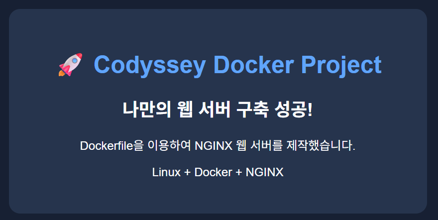

# 🚀 개발 워크스테이션 구축 프로젝트 결과보고서

## 1. 프로젝트 개요

본 프로젝트는 개발 환경 구축에 필요한 Linux 터미널 조작, 파일 권한 관리, Docker 컨테이너 운영 및 Git/GitHub 버전 관리 환경을 직접 구성하고 실습하는 것을 목적으로 한다.

### 주요 실습 목표
- Linux 기본 명령어를 활용한 파일 및 디렉터리 관리
- chmod를 이용한 파일 및 디렉터리 권한 관리
- Docker 이미지 및 컨테이너 생성과 관리
- Dockerfile을 활용한 커스텀 이미지 제작
- 포트 매핑을 통한 컨테이너 서비스 접속
- 바인드 마운트 및 Docker 볼륨을 통한 데이터 영속성 검증
- Git을 활용한 버전 관리 및 GitHub 연동

---

## 2. 실행 환경

| 구분 | 환경 및 버전 |
|---|---|
| Host OS | Windows 11 |
| 가상화 환경 | WSL2 |
| Linux 배포판 | Ubuntu 26.04.1 LTS |
| Linux Kernel | 6.18.54.1-microsoft-standard-WSL2 |
| Shell | /bin/bash |
| Bash 버전 | 5.3.9(1)-release |
| Terminal | VS Code 통합 터미널 |
| Docker Desktop | 4.98.0 |
| Docker Client | 29.9.2 |
| Docker Engine | 29.9.2 |
| Docker Compose | 5.6.1 |
| Git | 2.53.0 |
| Visual Studio Code | 1.143.1 |

### 환경 확인 명령어

```bash
uname -a                 # 명령어: uname은 시스템 정보를 출력하며 -a는 전체 정보를 표시한다. 실행 환경 확인에 사용한다.
cat /etc/os-release      # 명령어: cat은 파일 내용을 출력한다. Ubuntu 배포판과 버전을 확인한다.
echo $SHELL              # 명령어: echo는 문자열이나 변수 값을 출력한다. 현재 셸 경로를 확인한다.
bash --version           # 명령어: bash는 Bash 셸이며 --version은 버전을 표시한다. 셸 버전을 확인한다.
docker --version         # 명령어: docker --version은 Docker CLI 버전을 표시한다. CLI 설치를 확인한다.
docker version           # 명령어: docker version은 Client와 Server 버전을 표시한다. Engine 연결도 확인한다.
docker compose version   # 명령어: docker compose version은 Compose 버전을 표시한다. Compose 사용 가능 여부를 확인한다.
git --version            # 명령어: git --version은 Git 버전을 표시한다. 로컬 Git 설치를 확인한다.
code --version           # 명령어: code --version은 VS Code CLI 버전을 표시한다. 터미널 연동을 확인한다.
```

---

## 3. 수행 항목 체크리스트

- [x] Linux 터미널 기본 명령어 실습
- [x] 파일 및 디렉터리 생성, 복사, 이동, 삭제
- [x] chmod를 이용한 파일 및 디렉터리 권한 설정
- [x] Docker 설치 및 기본 환경 확인
- [x] hello-world 컨테이너 실행
- [x] Ubuntu 컨테이너 생성
- [x] Docker 이미지 및 컨테이너 상태 확인
- [x] Dockerfile을 이용한 커스텀 이미지 제작
- [x] 포트 매핑 및 브라우저 접속 확인
- [x] 바인드 마운트 데이터 변경 반영 확인
- [x] Docker 볼륨 데이터 영속성 검증
- [ ] Git 저장소 초기화 및 커밋 실습
- [ ] GitHub 원격 저장소 연결 및 Push 확인

※ 실제 실습과 검증이 완료된 항목만 완료 처리한다.

### 명령어 주석 읽기

각 명령의 뜻은 README에서 처음 나올 때만 `명령어: 뜻`으로 풀이한다. 같은 명령이 다시 나오면 뜻을 반복하지 않고 해당 단계에서 실행한 이유를 적는다. 옵션이나 인자가 달라져 동작이 달라지는 경우에는 새 부분의 뜻도 설명한다. `#` 뒤의 주석은 실행되지 않는다.

---

## 4. Linux 터미널 및 권한 관리 실습

### 4.1 기본 명령어 실습

실습 경로:

`~/codyssey-practice/terminal-test`

| 명령어 | 기능 |
|---|---|
| pwd | 현재 작업 디렉터리 확인 |
| ls -la | 숨김 파일을 포함한 목록 확인 |
| cd | 디렉터리 이동 |
| mkdir | 디렉터리 생성 |
| touch | 파일 생성 |
| cp | 파일 복사 |
| mv | 파일 이동 및 이름 변경 |
| cat | 파일 내용 출력 |
| rm | 파일 삭제 |
| realpath | 절대 경로 확인 |

### 4.2 실제 실행 명령어

```bash
mkdir -p ~/codyssey-practice/terminal-test
# 명령어: mkdir은 디렉터리를 만든다. -p는 상위 디렉터리도 만들고 이미 있어도 오류 없이 진행한다.
# 사용 이유: 파일 실습을 진행할 작업 공간을 준비한다.
cd ~/codyssey-practice/terminal-test  # 사용 이유: 이후 상대 경로 명령이 이 실습 폴더를 기준으로 동작하도록 이동한다.
mkdir test-dir  # 사용 이유: -p 옵션 없이도 실습용 하위 폴더를 만들 수 있음을 확인한다.
echo "Hello Codyssey" > test.txt  # 명령어: echo는 문자열을 출력하고 >는 출력을 파일에 기록하며 기존 내용은 덮어쓴다.
touch .hidden-test  # 명령어: touch는 파일을 만들거나 수정 시각을 갱신한다. 점(.)으로 시작하면 숨김 파일이다.
ls -la  # 명령어: ls는 항목 목록을 표시한다. -l은 상세 형식, -a는 숨김 항목 포함을 뜻한다.
cp test.txt copy.txt  # 명령어: cp는 파일을 복사한다. 원본을 보존한 복사본을 만들어 복사를 확인한다.
mv copy.txt renamed.txt  # 명령어: mv는 파일을 이동하거나 이름을 바꾼다. 복사본의 이름을 바꿔 동작을 확인한다.
cat test.txt  # 명령어: cat은 파일 내용을 출력한다. 원본과 복사본 내용을 확인한다.
cat renamed.txt
rm renamed.txt  # 명령어: rm은 파일을 삭제한다. 실습에서 만든 복사본을 정리한다.
realpath test.txt  # 명령어: realpath는 경로를 정규화한 절대 경로로 출력한다. 파일의 전체 위치를 확인한다.
```

### 4.3 파일 및 디렉터리 권한 관리

Linux의 chmod 명령어를 이용하여 파일과 디렉터리의 권한을 설정하였다.

명령어: `chmod 숫자 경로`는 소유자/그룹/그 외 사용자의 읽기·쓰기·실행 권한을 숫자로 설정한다. 이 실습에서는 `644`와 `755`를 적용해 기본 파일 및 디렉터리 권한을 확인했다.

| 대상 | 변경 전 | 실행 명령 | 변경 후 |
|---|---|---|---|
| permission-test.txt | 644 (-rw-r--r--) | chmod 644 permission-test.txt | 644 (-rw-r--r--) |
| permission-dir | 755 (drwxr-xr-x) | chmod 755 permission-dir | 755 (drwxr-xr-x) |

※ 실습 당시 기본 생성 권한이 이미 644와 755였으므로 변경 전후 권한 비트에는 차이가 없었다.

권한 확인 명령어:

```bash
stat -c '%a %A %n' permission-test.txt permission-dir
# 명령어: stat은 파일 정보를 출력한다. -c는 형식을 지정하며 %a/%A/%n은 숫자 권한/문자 권한/이름이다.
# 사용 이유: chmod로 설정한 파일과 디렉터리의 권한을 확인한다.
find . -maxdepth 2 -printf '%M %p\n'
# 명령어: find는 파일을 찾는다. -maxdepth는 탐색 깊이, -printf는 출력 형식을 지정한다.
# 사용 이유: 현재 폴더 아래 두 단계까지 항목 권한을 확인한다.
```

---

## 5. Docker 설치 및 컨테이너 운영

### 5.1 Docker 환경 확인

Docker Desktop과 WSL2 Ubuntu 간 연동 상태를 확인하였다.

```bash
docker --version  # 사용 이유: Docker CLI 버전 및 Client와 Server 연결 상태를 확인한다.
docker version
docker info  # 명령어: docker info는 Engine의 상세 설정과 실행 정보를 출력한다. 서버가 작동하는지 진단한다.
docker context show  # 명령어: docker context show는 현재 선택된 Engine 연결 대상을 보여준다. 연결 경로를 확인한다.
docker images
# 명령어: docker images는 로컬 이미지 목록을 보여준다.
# 사용 이유: 실습에서 사용할 이미지가 내려받아져 있는지 확인한다.
docker ps -a
# 명령어: docker ps는 실행 중인 컨테이너를 보여준다. -a를 붙이면 종료된 컨테이너도 포함한다.
# 사용 이유: 기존 컨테이너의 실행 및 종료 상태를 확인한다.
```

확인 결과:
- Docker Client 정상 작동
- Docker Engine 정상 연결
- Docker Context: default
- Client 및 Server OS/Arch: linux/amd64
- Docker Desktop 서버 연결 확인

### 5.2 hello-world 컨테이너 실행

```bash
docker run hello-world  # 명령어: docker run은 이미지로 컨테이너를 만들고 실행한다. hello-world로 Docker 실행을 검증한다.
```

실행 결과:
- hello-world 이미지 다운로드 확인
- 컨테이너 실행 성공
- "Hello from Docker!" 출력 확인

### 5.3 Ubuntu 컨테이너 생성

```bash
docker run -it --name codyssey-ubuntu ubuntu bash
# 사용 이유: Ubuntu 이미지로 컨테이너를 만들고 대화형 Bash에 접속한다.
# -it는 터미널 입력/출력을 연결하고, --name은 컨테이너 이름을 지정한다.
```

Ubuntu 이미지를 기반으로 컨테이너를 생성하고 대화형 Bash 터미널에 접속하였다.

컨테이너 내부 확인 명령어:

```bash
pwd  # 명령어: pwd는 현재 작업 디렉터리 경로를 출력한다. 컨테이너 내부 위치를 확인한다.
ls -la  # 사용 이유: 컨테이너 내부 파일 목록을 확인한다.
echo "Hello Codyssey Docker"  # 사용 이유: 컨테이너 안에서 명령을 실행할 수 있는지 문자열 출력으로 확인한다.
cat /etc/os-release  # 사용 이유: 컨테이너의 Ubuntu 배포판 정보를 확인한다.
exit  # 명령어: exit은 현재 셸 세션을 종료한다. 대화형 컨테이너 셸에서 빠져나온다.
```

※ 내부 명령 실행 결과는 추가 확인 후 기록한다.

### 5.4 Docker 이미지 및 컨테이너 관리

실제 확인된 이미지:

| 이미지 | 확인 결과 |
|---|---|
| hello-world:latest | 다운로드 및 실행 확인 |
| ubuntu:latest | 다운로드 및 컨테이너 생성 확인 |

컨테이너 확인 명령어:

```bash
docker images  # 사용 이유: 로컬에 있는 이미지 목록을 다시 확인한다.
docker ps  # 명령어: docker ps는 실행 중 컨테이너 목록을 출력한다. 이 단계에서는 실행 중인 컨테이너를 확인한다.
docker ps -a  # 사용 이유: 종료된 Ubuntu 컨테이너까지 포함해 상태를 비교한다.
docker logs codyssey-ubuntu  # 명령어: docker logs는 컨테이너 로그를 출력한다. Ubuntu 컨테이너의 실행 결과를 확인한다.
docker stats --no-stream  # 명령어: docker stats는 자원 사용량을 표시한다. --no-stream은 한 번만 출력하게 한다.
```

기존 Ubuntu 컨테이너 확인 결과:
- 컨테이너 이름: codyssey-ubuntu
- 이미지: ubuntu
- 실행 명령: bash
- 상태: Exited (0)

---

## 6. Dockerfile 기반 커스텀 이미지 제작

※ 실습 진행 예정

Dockerfile을 이용하여 기본 이미지를 확장하고 정적 웹 콘텐츠를 제공하는 커스텀 이미지를 제작한다.

### 6.1 Dockerfile 작성

NGINX 기반의 Alpine Linux 이미지를 베이스 이미지로 사용하여 커스텀 웹 서버 이미지를 제작하였다.

프로젝트 구조:

```text
codisey1/
├── README.md
└── docker-web/
    ├── Dockerfile
    └── html/
        └── index.html
```

Dockerfile:

```dockerfile
FROM nginx:alpine
# 명령어: FROM은 새 이미지의 기반 이미지를 지정한다. NGINX 웹 서버를 재사용한다.
COPY html/index.html /usr/share/nginx/html/index.html
# 명령어: COPY는 빌드 컨텍스트의 파일을 이미지 안으로 복사한다. 사용자 HTML을 웹 루트에 둔다.
EXPOSE 80
# 명령어: EXPOSE는 컨테이너가 사용할 포트를 문서화한다. NGINX의 HTTP 포트 80을 나타낸다.
```

주요 명령어 설명:

| 명령어 | 기능 |
|---|---|
| FROM | NGINX Alpine 이미지를 기반으로 사용 |
| COPY | HTML 파일을 컨테이너 내부 웹 루트로 복사 |
| EXPOSE | 컨테이너가 사용하는 웹 서비스 포트 80을 문서화 |

### 6.2 커스텀 이미지 빌드

실행 명령어:

```bash
cd ~/codisey1/docker-web  # 사용 이유: Dockerfile과 html 폴더가 있는 위치로 이동해 이미지를 빌드한다.
docker build -t codyssey-web:v1 .
# 명령어: docker build는 Dockerfile로 이미지를 만든다. -t는 이름:태그를 지정하고 .은 현재 폴더를 빌드 컨텍스트로 쓴다.
# 사용 이유: 작성한 웹 콘텐츠를 포함한 커스텀 이미지를 만든다.
docker images  # 사용 이유: 빌드한 이미지가 로컬에 생성됐는지 확인한다.
```

실행 결과:

- 이미지 이름: codyssey-web
- 태그: v1
- 빌드 결과: FINISHED
- 이미지 ID: 8d08f8308974
- 이미지 크기: 약 93.7MB

### 6.3 컨테이너 실행

실행 명령어:

```bash
docker run -d \
  --name codyssey-web \
  -p 8080:80 \
  codyssey-web:v1
# 명령어: docker run은 이미지로 컨테이너를 실행한다. -d는 백그라운드, --name은 이름 지정, -p는 호스트 포트와 컨테이너 포트 연결이다.
# 사용 이유: 커스텀 이미지로 웹 서버를 실행해 호스트에서 접속할 수 있게 한다.
```

실행 결과:

- 컨테이너 이름: codyssey-web
- 컨테이너 ID: b77391600c39
- 실행 상태: Up
- 포트 매핑: 8080:80

### 6.4 Dockerfile 기반 이미지 검증

Docker 이미지 및 컨테이너 상태 확인:

```bash
docker images  # 사용 이유: 웹 컨테이너가 사용할 이미지가 로컬에 있는지 확인한다.
docker ps  # 사용 이유: 웹 컨테이너의 실행 상태와 포트 연결을 확인한다.
docker logs codyssey-web  # 사용 이유: NGINX 시작 및 요청 로그를 확인한다.
```

컨테이너가 정상 실행 중이며 호스트의 8080번 포트와 컨테이너의 80번 포트가 연결된 것을 확인하였다.

---

## 7. 포트 매핑 및 네트워크 검증

### 7.1 포트 매핑 설정

Docker 실행 시 `-p 8080:80` 옵션을 적용하여 호스트와 컨테이너의 포트를 연결하였다.

| 구분 | 포트 |
|---|---|
| 호스트 포트 | 8080 |
| 컨테이너 포트 | 80 |
| 웹 서버 | NGINX |

### 7.2 웹 서버 접속 검증

실행 명령어:

```bash
curl http://localhost:8080  # 명령어: curl은 URL에 HTTP 요청을 보내고 응답을 출력한다. 호스트 포트로 웹 페이지를 확인한다.
```

검증 결과:

- HTML 문서 정상 반환
- 사용자 정의 웹 페이지 내용 확인
- NGINX 로그에서 HTTP 200 응답 확인

주요 로그:

```text
"GET / HTTP/1.1" 200 910
```

이를 통해 Docker 컨테이너 내부의 NGINX 웹 서버가 호스트의 8080번 포트를 통해 정상적으로 응답하는 것을 확인하였다.

※ 브라우저 접속 화면은 별도 캡처 후 증거 자료에 추가한다.

### 7.3 브라우저 접속 검증

Windows 웹 브라우저에서 `http://localhost:8080`에 접속하여 사용자 정의 HTML 페이지가 정상적으로 표시되는 것을 확인하였다.

**검증 결과**
- 접속 주소: http://localhost:8080
- 웹 서버: NGINX
- HTTP 응답 코드: 200
- 사용자 정의 HTML 콘텐츠 표시 확인

**실습 증거 자료**



---


### 8. 데이터 영속성(Data Persistence)

#### 8.1 Bind Mount 실습

- 호스트 디렉터리와 컨테이너 내부 웹 디렉터리 연결
- NGINX 컨테이너에 호스트의 HTML 파일 연결
- 읽기 전용 옵션(`:ro`) 적용
- 호스트 HTML 파일 수정 후 컨테이너 재시작 및 이미지 재빌드 없이 변경 사항 반영 확인

**실행 환경**

- 컨테이너: `codyssey-bind`
- 호스트 경로: `./docker-web-bind/html`
- 컨테이너 경로: `/usr/share/nginx/html`
- 포트 매핑: `8081:80`

**검증 명령어**

```bash
docker inspect codyssey-bind --format '{{json .Mounts}}'
# 명령어: docker inspect는 Docker 객체의 상세 정보를 출력하며 --format은 표시 형식을 제한한다.
# 사용 이유: 바인드 마운트 경로와 읽기 전용 설정을 확인한다.
curl http://localhost:8081  # 사용 이유: 호스트 파일의 수정 내용이 웹 응답에 반영됐는지 확인한다.
```

**검증 결과**

- Mount Type: `bind`
- Mode: `ro`
- RW: `false`
- HTML 파일의 BEFORE → AFTER 변경 사항 반영 확인

#### 8.2 Docker Volume 실습

- Docker Volume 생성
- Ubuntu 컨테이너의 `/data` 경로에 Volume 연결
- 컨테이너 내부에 `test.txt` 파일 생성 및 데이터 저장
- 기존 컨테이너 삭제 후 새로운 컨테이너 실행
- 기존 데이터 유지 및 재확인

**실행 명령어**

```bash
docker volume create codyssey-data
# 명령어: docker volume create는 이름 있는 볼륨을 생성한다. 컨테이너와 별도로 데이터를 보존할 공간을 준비한다.
docker run -it \
  --name codyssey-volume-test \
  -v codyssey-data:/data \
  ubuntu bash
# 사용 이유: Ubuntu 컨테이너에 접속해 볼륨에 데이터를 기록한다.
# -v 호스트볼륨:컨테이너경로 형식으로 볼륨을 연결한다. -it는 대화형 터미널, --name은 컨테이너 이름을 지정한다.
```

**데이터 저장**

```bash
cd /data  # 사용 이유: 볼륨 마운트 경로로 이동한다.
echo "Docker Volume 데이터 보존 실습 성공!" > test.txt  # 사용 이유: 확인할 텍스트를 볼륨에 기록한다. >는 파일을 새로 만들거나 기존 내용을 덮어쓴다.
cat test.txt  # 사용 이유: 기록된 내용을 확인한다.
```

**컨테이너 삭제 및 데이터 검증**

```bash
docker rm codyssey-volume-test  # 명령어: docker rm은 컨테이너를 삭제한다. 볼륨은 남겨 두고 첫 컨테이너만 제거해 보존 여부를 확인한다.
docker run -it \
  --name codyssey-volume-check \
  -v codyssey-data:/data \
  ubuntu bash
# 사용 이유: 같은 볼륨을 새 컨테이너에 연결해 이전 파일이 남아 있는지 검증한다.
cd /data  # 사용 이유: 새 컨테이너에서 볼륨이 연결된 위치로 이동한다.
ls -l  # 명령어: ls -l은 파일 목록을 상세 형식으로 표시한다. 이전 파일 보존 여부를 확인한다.
cat test.txt  # 사용 이유: 이전에 저장한 파일의 내용이 유지됐는지 확인한다.
```

**검증 결과**

- 기존 컨테이너 삭제 완료
- 새로운 컨테이너에서 기존 `test.txt` 파일 확인
- 저장된 데이터가 그대로 유지됨
- Volume 확인 명령어: `docker volume inspect codyssey-data`는 지정한 볼륨의 상세 정보를 출력한다. 볼륨 설정과 연결 정보를 확인할 때 사용한다.

**결론:** 컨테이너를 삭제하더라도 Docker Volume을 삭제하지 않으면 데이터가 유지됨을 확인하였다.


---

## 9. Git 및 GitHub 버전 관리

### 9.1 Git 환경 확인

```bash
git --version
git config --global user.name
# 명령어: git config --global은 사용자 전체에 적용되는 Git 설정을 조회/변경한다. user.name은 커밋 작성자 이름이다.
# 사용 이유: 커밋에 기록될 작성자 설정을 확인한다.
git config --global init.defaultBranch  # 명령어: init.defaultBranch는 새 저장소에서 사용할 기본 브랜치 설정이다.
git status  # 명령어: git status는 작업 트리와 스테이징 상태를 보여준다. 저장소 변경 여부를 확인한다.
git remote -v  # 명령어: git remote -v는 원격 저장소 별칭과 주소를 보여준다. 원격 연결 여부를 확인한다.
```

현재 확인된 설정:

| 항목 | 확인 결과 |
|---|---|
| Git 버전 | 2.53.0 |
| 사용자 이름 | anki |
| 기본 브랜치 | main |
| 원격 저장소 | 추가 확인 필요 |

### 9.2 Git 기본 작업 흐름

```bash
git init  # 명령어: git init은 현재 폴더를 로컬 Git 저장소로 초기화한다.
git add README.md  # 명령어: git add는 변경 파일을 다음 커밋에 포함하도록 스테이징한다.
git commit -m "Initial commit"  # 명령어: git commit은 스테이징된 변경을 이력으로 저장한다. -m은 커밋 메시지를 지정한다.
git log --oneline  # 명령어: git log는 커밋 이력을 표시한다. --oneline은 한 커밋을 한 줄로 요약한다.
```

Git은 로컬 버전 관리 도구이며 GitHub은 원격 저장소 및 협업 플랫폼이다.

### 9.3 개념 설명서

#### 절대 경로와 상대 경로

- **절대 경로**는 파일 시스템의 기준점(`/`)부터 목적지까지 적은 전체 경로다. 현재 어느 폴더에 있든 같은 위치를 가리킨다. 예: `/home/anki/codyssey-practice/terminal-test/test.txt`.
- **상대 경로**는 현재 작업 디렉터리(`pwd`로 확인)에서 목적지까지 적는다. 위 실습 폴더 안에 있을 때 `test.txt`는 파일을 가리키고, `../other/file.txt`는 상위 폴더로 올라간 뒤 이동한다. `.`은 현재 폴더, `..`은 부모 폴더다.
- `~/...`는 셸이 현재 사용자의 홈 디렉터리로 확장하는 표기다. 예를 들어 `/home/anki`가 홈이면 `~/codyssey-practice`는 `/home/anki/codyssey-practice`와 같다. `realpath test.txt`는 상대 경로를 확인 가능한 절대 경로로 바꿔 보여준다.

#### 파일 권한: r, w, x와 숫자 표기

Linux 권한은 소유자(user), 그룹(group), 그 외 사용자(others) 각각에 대해 읽기(`r`), 쓰기(`w`), 실행(`x`) 여부를 정한다. 숫자 표기는 각 자리에서 `r=4`, `w=2`, `x=1`을 더한 값이다.

| 숫자 | 권한 | 뜻 |
|---|---|---|
| 7 | `rwx` (4+2+1) | 읽기, 쓰기, 실행 |
| 5 | `r-x` (4+1) | 읽기, 실행 |
| 6 | `rw-` (4+2) | 읽기, 쓰기 |
| 4 | `r--` | 읽기만 |

`chmod 755 파일`의 세 자리는 순서대로 소유자/그룹/그 외 사용자를 뜻하므로 `rwxr-xr-x`가 된다. `chmod 644 파일`은 `rw-r--r--`로, 소유자는 읽고 쓸 수 있고 나머지는 읽을 수만 있다. 디렉터리에서 `x`는 그 안의 항목에 접근하거나 경로를 통과할 수 있는 권한을 뜻한다. 따라서 디렉터리에 보통 `755`, 일반 텍스트 파일에 `644`를 사용한다. `chmod`는 이 권한 비트를 바꾸며, 파일 소유자나 시스템 정책에 따라 변경이 제한될 수 있다.

#### Docker 커스텀 이미지

이미지는 컨테이너 생성의 바탕이 되는 실행 환경과 파일의 묶음이고, 컨테이너는 그 이미지로 실행한 인스턴스다. 기존 이미지를 `FROM`으로 지정한 Dockerfile에 필요한 설정이나 파일을 더하고 `docker build -t 이름:태그 .`를 실행하면 커스텀 이미지를 만들 수 있다. 여기서 `.`은 현재 디렉터리를 빌드 입력(빌드 컨텍스트)으로 전달한다. 이 실습에서는 `nginx:alpine`을 바탕으로 HTML을 복사해 `codyssey-web:v1`을 만들었다. 이후 이 이미지로 컨테이너를 여러 번 실행할 수 있다.

#### 포트 매핑이 필요한 이유

컨테이너의 네트워크는 호스트와 구분되어 있으므로, 컨테이너 안에서 NGINX가 80번 포트로 대기해도 호스트 브라우저에서 자동으로 접근할 수 있는 것은 아니다. `-p 8080:80`은 **호스트 포트:컨테이너 포트** 순서로 연결을 만들어 `http://localhost:8080` 요청을 컨테이너의 80번으로 전달한다. Dockerfile의 `EXPOSE 80`은 사용 포트를 문서화하는 설정이며, 실제 호스트 연결은 `docker run -p`가 만든다.

#### Docker 볼륨과 데이터 영속성

컨테이너 내부 파일 시스템에만 저장한 데이터는 컨테이너를 제거할 때 함께 사라질 수 있다. Docker Volume은 컨테이너와 별도로 관리되는 저장 공간이다. `-v codyssey-data:/data`처럼 연결하면 컨테이너의 `/data`를 볼륨에 연결한다. 해당 컨테이너를 삭제하고 새 컨테이너에 같은 볼륨을 다시 붙여도 파일이 남아 있어 데이터베이스 파일이나 업로드 파일처럼 실행 인스턴스보다 오래 보존할 데이터에 적합하다. 볼륨 자체를 `docker volume rm`으로 삭제하면 그 안의 데이터도 제거된다.

바인드 마운트는 호스트의 특정 경로를 컨테이너에 직접 연결한다(예: `-v ./html:/usr/share/nginx/html:ro`). 호스트에서 파일을 편집하면 컨테이너에서도 바로 보이므로 개발 중 소스 공유에 편리하다. Volume은 Docker가 관리하는 저장 공간이고, 바인드 마운트는 사용자가 지정한 호스트 경로라는 차이가 있다.

#### Git과 GitHub의 역할

**Git**은 내 컴퓨터에서 파일 변경 이력을 기록하고 비교·되돌리는 버전 관리 도구다. `git init`, `git add`, `git commit`, `git log`는 로컬 저장소 안에서 동작하므로 GitHub 계정이나 인터넷이 없어도 이력을 관리할 수 있다. **GitHub**은 Git 저장소를 원격 서버에 보관하고 다른 사람과 공유·협업하도록 제공하는 플랫폼이다. `git remote`로 원격 주소를 연결하고 `git push`로 커밋을 올리면 다른 컴퓨터나 협업자가 접근할 수 있다. 즉 Git이 이력을 관리하는 도구이고 GitHub은 그 저장소를 원격에 호스팅하고 협업 기능을 제공하는 서비스다.

원격 저장소 연결이 확인된 후 업로드한다.

```bash
git remote -v  # 사용 이유: origin 원격 저장소 주소가 설정되어 있는지 확인한다.
git push -u origin main
# 명령어: git push는 로컬 커밋을 원격 저장소로 보낸다. -u는 이후 기본 추적 관계를 설정한다.
# 사용 이유: 원격 연결을 확인한 뒤 main 브랜치를 GitHub에 업로드한다.
```

---

## 10. 트러블슈팅 (Troubleshooting)

### Case 01. Docker와 WSL2 연결 오류

**문제**

Docker 명령 실행 시 Docker Engine에 연결하지 못하는 오류가 발생하였다.

```text
failed to connect to the docker API
The system cannot find the file specified.
```

**원인 가설**

WSL2 내부에서 Docker Desktop의 CLI 연동 경로 및 Docker Engine 연결이 정상적으로 제공되지 않는 상태로 판단하였다.

**확인 과정**

```bash
docker context show  # 사용 이유: 현재 Docker 연결 대상을 확인해 오류 상황을 진단한다.
docker version  # 사용 이유: Docker Server가 응답하는지 확인한다.
ls -l /usr/bin/docker  # 명령어: ls -l은 파일 상세 목록을 표시한다. /usr/bin/docker의 존재와 권한을 점검한다.
```

초기에는 Docker CLI의 연결 경로가 정상적으로 작동하지 않았으며, WSL Docker Desktop 연동 경로도 확인되지 않았다.

**해결 및 검증**

이후 Docker Desktop과 WSL2 연동이 복구된 상태에서 다음 결과를 확인하였다.

```text
Docker version 29.9.2
OS/Arch: linux/amd64
Server: Docker Desktop 4.98.0
```

※ 정확한 설정 변경 원인은 추가 확인이 필요하다.

### Case 02. Git 저장소 외부에서 commit 실행

**문제**

Git 저장소가 아닌 디렉터리에서 commit 명령어를 실행하여 오류가 발생하였다.

```text
fatal: not a git repository (or any of the parent directories): .git
```

**원인**

현재 작업 디렉터리가 Git 저장소로 초기화된 폴더 내부가 아니었다.

**해결 방법**

기존 저장소 위치를 확인한 후 해당 디렉터리로 이동하여 Git 명령어를 실행한다.

```bash
pwd  # 사용 이유: 현재 작업 디렉터리를 확인한다.
find ~ -maxdepth 5 -type d -name .git -print
# 명령어: find는 조건에 맞는 경로를 검색한다. -maxdepth는 깊이 제한, -type d는 디렉터리만, -name은 이름 조건, -print는 경로 출력이다.
# 사용 이유: 홈 아래에서 기존 .git 저장소 위치를 찾는다.
cd 저장소_경로  # 사용 이유: 찾은 저장소 폴더로 이동한다. 저장소_경로는 실제 경로로 바꿔 입력한다.
git status  # 사용 이유: 저장소 안에서 변경 상태를 확인해 올바른 위치인지 검증한다.
```

---

## 11. 학습 내용 및 결과

1. Linux 터미널의 기본 명령어를 사용하여 파일과 디렉터리를 생성, 복사, 이동 및 삭제할 수 있다.
2. chmod를 통해 파일과 디렉터리의 권한을 설정하고 확인할 수 있다.
3. Docker 이미지와 컨테이너의 차이 및 기본 실행 구조를 이해하였다.
4. Docker Client와 Server의 연결 상태를 확인하고 컨테이너를 관리하는 방법을 학습하였다.
5. Git은 로컬에서 변경 이력을 관리하며 GitHub은 원격 저장소로 활용된다는 점을 이해하였다.

※ 미완료 실습은 진행 후 결과를 추가한다.

---

## 12. 실습 증거 자료

실습 과정에서 생성한 스크린샷과 결과 자료를 아래 폴더에 저장한다.

```text
codisey1/
├── README.md
├── hello.py
└── images/
    ├── terminal-practice.png
    ├── docker-hello-world.png
    ├── docker-container.png
    ├── docker-web-browser.png
    └── github-commit.png
```

※ 실제로 저장한 이미지 파일만 README에 연결한다.
